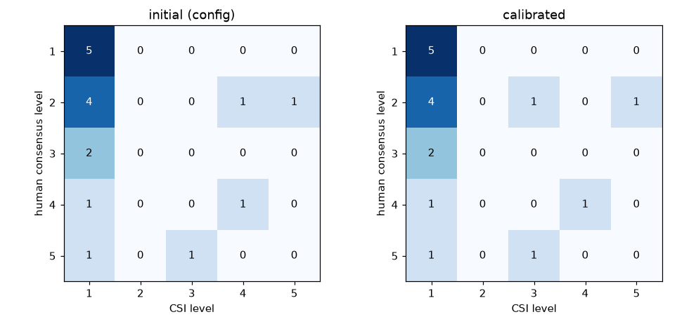

# 창문 오염 심각도 지수 CSI와 청소 우선순위

창문 하나의 오염 정도를 0~1 사이 숫자 하나(CSI)로 요약하고, 구간별로 청소 우선순위 5단계로 나눈다.
코드: `cv/facade_cv/contamination/grade.py`, 설정: `config/grading.yaml`, 참고문헌 번호는 [REFERENCES.md](REFERENCES.md).

> ⚠️ **수치는 모두 보정 전 초기값이다.** 식의 **구조**는 문헌을 따르지만 종류 가중치 k_t, 심각도 경계(ΔE 6/15),
> level 경계(0.009/0.022/0.044/0.089), 창틀 마진(6%)은 자체로 정한 값이며 실측으로 검증되지 않았다.
> 사람 평가로 보정하는 절차는 아래 [보정](#보정)에 있다.

## 1. 식

$$
\mathrm{CSI} = \frac{\sum_j A_j \, k_s(j) \, k_t(j)}{A_g \; k_{s,\max} \; k_{t,\max}}
$$

| 기호 | 뜻 | 값·구하는 법 | 근거 |
|---|---|---|---|
| A_g | 유리 면적 | 정면화 창문 crop − 창틀 마진(각 변 6%) − **가림**(나무·전선·기둥, detect 후처리 occlusion) | [R2] 분모 A, 가림 제외는 자체 |
| A_j | 오염 영역 j의 면적 | 영역 ∩ 유리 (창틀·가림 위 부분은 빼고 센다). 영역끼리 겹치면 k_t가 큰 종류가 그 픽셀을 가진다 | [R2] A_n, [R5] 피복률 |
| A_j / A_g | 면적 비율 (`area_ratio`) | 0~1 | [R5] |
| k_s(j) | 심각도 1/2/3 | 영역 평균색과 **같은 창문의 깨끗한 유리** 평균색의 CIELAB 색차 ΔE*ab: < 6 → 1, 6~15 → 2, ≥ 15 → 3 | 구조 [R2] k_n, 불투명도 [R5], ΔE [R22], JND [R23] |
| k_s,max | 심각도 최댓값 | 3 | [R2] k |
| k_t(j) | 오염 종류 가중치 | dust 0.5 · stain 0.8 · grime 1.0 · heavy 1.5 (초기값) | [R6] |
| k_t,max | 종류 가중치 최댓값 | 1.5 (heavy) | [R2] 정규화 |
| level | 청소 우선순위 | CSI < 0.009 → 1 청소 불필요, < 0.022 → 2 경과 관찰, < 0.044 → 3 가급적 청소, < 0.089 → 4 청소 필요, 그 이상 → 5 우선 청소 (경계값은 상위 level) | [R4] |

**범위 0~1**: 영역은 유리 안에서 겹치지 않으므로 Σ A_j ≤ A_g이고, k_s ≤ k_s,max, k_t ≤ k_t,max이므로 분자 ≤ 분모.
CSI = 1은 "유리 전체가 가장 무거운 종류(heavy)의 가장 짙은(k_s 3) 오염으로 덮인 상태"다.
CSI = 0.05는 "유리 면적의 5%가 최악의 오염으로 덮인 것과 같은 정도"로 읽는다 (최악 오염 환산 면적 비율).

## 2. 항목별 근거와 왜 이 형태인가

### 구조 — 외벽 열화 심각도 지수 [R2], PCI [R4]
Gaspar & de Brito [R2]는 외벽 결함을 S_w = Σ(A_n · k_n · k_a,n) / (A · k)로 요약한다
(A_n 결함 면적, k_n 상태 등급, k_a,n 결함 유형 가중치, A 전체 면적, k 최고 등급). CSI는 이 식의 각 항을 창문에 맞게 바꾼 것이다:

| [R2] | CSI | 바꾼 이유 |
|---|---|---|
| 결함 면적 A_n | 오염 영역 면적 A_j | 같음 |
| 상태 등급 k_n (0~4) | 심각도 k_s (1~3) | 영상에서 안정적으로 나눌 수 있는 단계가 3개 정도라고 봄 (자체). 0은 "오염 아님"이라 영역이 없다 |
| 유형 가중치 k_a,n | 종류 가중치 k_t | 같음 (외벽 결함 유형 → 유리 오염 종류) |
| 전체 면적 A | 유리 면적 A_g | 창틀·가린 부분은 오염을 관측할 수 없는 면적이라 분모에서 뺀다 |
| 최고 등급 k | k_s,max × k_t,max | [R2]는 k_a,n이 상대값이라 k만 나누지만, 0~1로 맞추려고 k_t 최댓값도 나눈다 |

여러 결함을 지수 하나로 합친 뒤 구간으로 나눠 관리자가 우선순위를 정하게 하는 방식은 ASTM D6433 PCI [R4]와 같다.
PCI의 deduct 곡선(결함 밀도에 따른 비선형 감점)은 쓰지 않았다 — 창문 오염용 곡선이 없고, 선형 합이 손으로 따라가기 쉽다.

### 면적 비율 A_j / A_g — [R5]
유리 오염의 투과율 손실은 오염이 덮은 면적(입자 피복률)에 따라 커진다 [R5]. 그래서 기본 척도는 면적이며,
창문 크기와 무관하게 비교하려고 유리 면적으로 나눈다.
- **창틀 마진 제외**: 정면화 crop 가장자리는 창틀·실링이라 오염 검출 대상이 아니다
- **가림 제외** (G5 `occlusion`): 창 앞 나뭇가지·전선은 어둡고 무늬가 있어 그대로 두면 "심한 오염"으로 잡히고,
  분모에 남으면 실제 오염 비율이 희석된다. 둘 다 막으려고 분자·분모 모두에서 뺀다 (예시 2)

### 심각도 k_s — 불투명도 [R5], 색차 ΔE [R22][R23]
같은 면적이라도 짙은 얼룩은 옅은 먼지보다 빛을 더 막는다 — [R5]는 투과율 손실이 피복률만이 아니라 오염층의 광학적 성질에 달렸음을 보인다.
영상에서 투과율을 직접 잴 수 없어, **영역 평균색과 같은 창문의 깨끗한 유리 평균색의 CIELAB 색차 ΔE*ab** [R22]를 불투명도의 대리로 쓴다.
- 같은 창문·같은 프레임 안에서 비교하므로 조명·노출·카메라 차이가 대부분 상쇄된다 (절대 밝기 임계값보다 견고)
- CIELAB는 사람이 느끼는 색 차이에 가깝게 만든 공간이고, 지각 가능 최소 색차(JND)는 약 2.3이다 [R23]
- 경계 6 ≈ 2.5 JND: 영상 압축 잡음·유리 뒤 실내 차이를 넘는 "분명히 보이는" 오염부터 k_s 2. 15는 유리 뒤가 거의 안 보이는 수준 (자체)
- 깨끗한 유리가 유리 면적의 5% 미만이면 기준색을 정할 수 없어 모든 영역을 k_s 3으로 둔다 (보수적)

### 종류 가중치 k_t — [R6]
같은 피복률에서도 오염 종류마다 투과율 손실 기울기가 다르다 [R6]. 그래서 종류마다 가중치를 둔다.
초기값 0.5 / 0.8 / 1.0 / 1.5는 "먼지 < 물얼룩 < 때 < 심한 오염(새똥·흙탕물)" 순서만 반영한 자체 값이다 — [R6]의 수치(태양광 유리,
먼지 성분별)는 창문 오염 종류와 대응되지 않아 쓰지 않았다. CSI는 k_t,max로 나누므로 **상대 크기만** 의미가 있다.
사람 평가로 보정한다 (아래).

### level 경계 — [R4] 방식, 초기값은 이전 score 환산
이전 지표 score = Σ type_ratio × weight의 경계(0.02/0.05/0.10/0.20)를 "모든 영역이 중간 심각도(k_s = 2)"라고 가정해 환산했다:
CSI = score × 2 / (3 × 1.5) = score × 0.444 → 0.009 / 0.022 / 0.044 / 0.089. 근거 있는 값이 아니라 출발점이며, 보정 대상이다.

### 곱셈 구조를 쓴 이유
면적·심각도·종류는 서로 독립인 성질이고, "넓을수록·짙을수록·질긴 종류일수록 청소가 급하다"는 단조성을 곱이 가장 단순하게 만족한다.
어느 하나가 0(오염 없음)이면 기여도 0이다. 각 영역의 기여(항)가 따로 보이므로 웹 상세 패널에서 "무엇 때문에 이 등급인지"를 영역 단위로 설명할 수 있다.

## 3. 손으로 따라가는 예시

공통: 정면화 창문 crop **300 × 200 px** (= 60,000 px), 창틀 마진 6% → 좌우 18 px, 위아래 12 px →
유리 264 × 176 = **46,464 px**. 분모 계수 k_s,max × k_t,max = 3 × 1.5 = **4.5**.
(두 예시는 `cv/tests/test_grade.py`가 실제 픽셀로 같은 값을 확인한다.)

### 예시 1 — 가림 없음

| 영역 | 종류 (k_t) | 면적 A_j | ΔE*ab | k_s | A_j × k_s × k_t |
|---|---|---|---|---|---|
| 1 | dust (0.5) | 80 × 50 = 4,000 | 3.3 | 1 | 4,000 × 1 × 0.5 = 2,000 |
| 2 | stain (0.8) | 50 × 30 = 1,500 | 8.5 | 2 | 1,500 × 2 × 0.8 = 2,400 |
| 3 | grime (1.0) | 30 × 20 = 600 | 21.3 | 3 | 600 × 3 × 1.0 = 1,800 |
| | | | | 합 | **6,200** |

CSI = 6,200 / (46,464 × 4.5) = 6,200 / 209,088 = **0.02965** → 0.022 ≤ CSI < 0.044 → **level 3 가급적 청소**.
영역별 기여: dust 0.00957 (32%), stain 0.01148 (39%), grime 0.00861 (29%). 면적은 dust가 가장 넓지만 기여는 stain이 가장 크다.

### 예시 2 — 나뭇가지가 창 일부를 가림

나뭇가지(occlusion) 101 × 64 = **6,464 px**가 유리 위에 있다 → A_g = 46,464 − 6,464 = **40,000 px**.

| 영역 | 종류 (k_t) | 전체 면적 | 가지 밑 | A_j (유리 안) | k_s | A_j × k_s × k_t |
|---|---|---|---|---|---|---|
| 1 | heavy (1.5) | 40 × 30 = 1,200 | 400 | 800 | 3 | 800 × 3 × 1.5 = 3,600 |
| 2 | dust (0.5) | 100 × 60 = 6,000 | 0 | 6,000 | 1 | 6,000 × 1 × 0.5 = 3,000 |
| | | | | | 합 | **6,600** |

CSI = 6,600 / (40,000 × 4.5) = 6,600 / 180,000 = **0.03667** → **level 3 가급적 청소**. 가림 비율 = 6,464 / 60,000 = 10.8% (crop 대비).

**가림을 빼지 않으면**: 어두운 가지 6,464 px가 heavy 오염으로 잡히고 분모도 46,464 그대로 →
(7,664 × 3 × 1.5 + 3,000) / 209,088 = 37,488 / 209,088 = 0.17929 → **level 5 우선 청소**로 과대평가된다.

## 4. 한계

1. **수치 미검증**: k_t, ΔE 경계, level 경계, 창틀 마진은 초기값. 보정 전 결과의 level은 상대 비교용으로만 쓴다
2. **ΔE는 불투명도의 대리일 뿐**: 유리 뒤가 어두운 실내면 같은 먼지도 ΔE가 커지고, 밝은 하늘이 비치면 작아진다.
   다시점 정렬(고정 패턴만 오염)이 반사를 줄이지만 유리 뒤 배경의 영향은 남는다. 투과율 실측과의 관계는 확인하지 않았다
3. **3단계 심각도는 거칠다**: 경계 근처(ΔE 5.9 vs 6.1)에서 기여가 두 배로 뛴다
4. **선형 합**: 작은 짙은 얼룩 여러 개와 넓고 옅은 먼지가 같은 CSI일 수 있지만 사람은 다르게 느낄 수 있다 (PCI의 비선형 감점 없음)
5. **종류 분류 오차가 그대로 전파**: dust ↔ heavy를 잘못 분류하면 k_t가 3배 차이
6. **가림 마스크 품질 의존**: 가지를 못 잡으면 예시 2처럼 과대평가, 너무 크게 잡으면 오염을 놓친다. 가림이 유리의 대부분이면 A_g가 작아 CSI가 흔들린다
7. **창틀 마진 고정 비율**: 창틀 폭이 창마다 다르다 (정면화 crop 품질에도 의존)
8. **사람 평가도 주관적**: 보정 목표(합의 등급) 자체의 일치도를 함께 보고한다

## 5. 오염 영역 검출과 유형 분류

CSI의 입력(영역별 A_j·종류·ΔE)을 정면화 창문 이미지에서 규칙으로 구한다. 코드 `cv/facade_cv/contamination/analyze.py`,
설정 `config/contamination.yaml`. 새 모델 학습은 없다. 커튼월 유리 먼지를 영상으로 추정해 청소 장치에 쓰는 선행 연구 [R7]이
밝기·배경 변화에 민감하다고 지적한 문제가 여기서도 핵심 한계다 — 그래서 최종 설계는 다시점 정렬(유리에 붙은 고정 패턴만 오염)이고,
아래 **단일 이미지 모드**는 관측이 부족할 때와 사진 시연용이다 (결과에 `low_confidence=true`).

### 처리 순서 (단일 이미지 모드)

1. **정면화**: 창문 4코너 → 직사각형 호모그래피 (긴 변 ≤ 640 px). 짧은 변 < 64 px면 분석하지 않는다 (미분석) — 창틀 마진 6%가 4 px 미만이라 유리 위 오염을 분해할 수 없다
2. **유리 A_g** = `grade.glass_mask` (각 변 6% 창틀 마진 − 가림). 영상 다시점 관측은 2단계
3. **창틀·창살 막대 제거**: 배경과 "다른" 픽셀의 행·열 투영에서 유리 높이(폭)의 85% 이상이 다른 열(행) = 수직(수평) 막대 → 제외.
   두께와 상관없다 (저해상도 창의 두꺼운 흰 창틀도 잡는다). 정면화 오차로 기운 막대는 짧은 변의 1%만큼 옆으로 번지게 해서 센다.
   단 막대 경계의 밝기 계단 |ΔL\*| (2 px 건너) 평균이 3 이상인 것만 막대로 본다 — 노을·하늘 그라데이션처럼 경계가 부드러운 띠는 남긴다
4. **칸별 배경**: 막대로 나뉜 유리 칸마다 LAB 채널별 2차 곡면을 강건하게 맞춘다 (잔차 하위 70%로 3회 재적합). 칸마다 유리 뒤 실내·커튼이 달라
   창 전체 기준색 하나로는 칸 전체가 "오염"이 되고, 하늘 반사의 완만한 밝기 기울기도 곡면이 흡수한다
5. **후보** = 칸 배경 대비 ΔE ≥ 10 또는 국소(큰 median) 배경 대비 ΔE ≥ 12 [R22] — 넓은 옅은 오염 / 작은 점·줄. 열림·닫힘으로 잡음 정리
6. **제외**: 반사광 = L\* ≥ 88 이고 채도 C\* ≤ 10 (팽창). 단 그중 **경계가 날카롭고(윤곽 밖 1 px 띠 L\* 기울기 ≥ 5/px)
   덩어리지고(solidity ≥ 0.8) 작은(≤ A_g × 5%)** 조각은 반사가 아니라 흰 오염(새똥)으로 남긴다 (`glare.keep_sharp`, 기본 켬) — 넓고 가장자리가
   부드러운 반사광은 그대로 제외. 물기(wet_glass) = 조각 15개 이상 + 하이라이트(L\* ≥ 80) 10% 이상 영역 → 제외 (켬, 효과·대가는 한계 4)
6-1. **반사 의심** (`reflection`, 켬): 묶은 영역이 A_g의 5% 이상이고, 영역 안쪽(외곽선 5 px 깎음)의 Canny 윤곽 밀도 ≥ 0.12 또는 LSD [R32] 긴 직선
   (짧은 변 15% 이상) 밀도 ≥ 0.01이면 = 비친 나무·건물 → CSI에서 빼고 `reflection_suspects`에 따로 기록 (웹: 노란 점선)
7. **묶기**: 후보를 짧은 변 × 0.1만큼 팽창해 연결 요소로 묶는다 → 흩어진 먼지 점들이 영역 하나가 된다. 면적 < A_g × 0.2%는 버린다
8. **유형** (특징값 모두 config, 첫 일치) — 표 아래
9. **ΔE·k_s**: 영역 안쪽(경계 1 px 침식) 평균 LAB와 **깨끗한 유리 기준색**(후보·반사광이 아닌 유리 중 L\* 사분위 사이 픽셀의 LAB 중앙값)의 CIE76 거리 [R22] → grading.yaml 경계로 k_s.
   깨끗한 유리가 A_g의 5% 미만이면 k_s = 3 (grade.py와 같은 규칙)
10. `grade.compute_csi` → `cleaning_level`. `raw_coverage_pct` = Σ A_j / A_g × 100 (가중치 없는 오염 면적 %, 웹 첫 줄 "오염 면적 12% · 3단계 가급적 청소"),
   `weighted_coverage_pct` = CSI × k_s,max × k_t,max × 100 = Σ (A_j/A_g × k_s × k_t) × 100 (%, 최대 450%, 웹 "상세"에 CSI와 함께)

| 유형 | 규칙 (위에서부터 첫 일치) | 의도 |
|---|---|---|
| heavy | ΔE ≥ 15 · solidity(가장 큰 조각 / 볼록 껍질) ≥ 0.75 · 면적 ≥ 0.3% · 조각 ≤ 3 · 주축 길이비 ≤ 3 | 새똥·흙탕물: 짙고 덩어리진 영역 |
| grime | 유리 아래·좌·우 가장자리 15% 띠 안 픽셀 ≥ 60% · 기준보다 어두움 (ΔL\* < 0) | 창틀 아래·가장자리에 붙은 어두운 때 |
| stain | (주축 길이비 ≥ 3 · 주축이 수직 ±25°) 또는 고리 (구멍/외곽 ≥ 0.15) | 빗물 자국 (세로 줄), 물방울 고리 |
| dust | 나머지 | 넓은 옅은 영역, 흩어진 점 |

출력: `windows/<id>/crop.jpg` (정면화 고해상도), `heatmap.png` (칸 배경 대비 ΔE, 진할수록 불투명), `overlay.png` (유형 색 = web/lib/palette.ts, 흰 선 = 제외한 반사광·막대).

### 다시점 모드 (`multiview.py`, 영상 run의 기본)

`recon3d.run`이 저장한 `recon/window_obs.json` (창문별 관측 프레임·4코너·가림)을 쓴다. 옛 run은 `recon3d.run --reuse-sfm`으로 SfM 없이 다시 만든다.

1. 관측마다 4코너 → 공통 크기(관측 사각형 크기 중앙값, 긴 변 ≤ 640) 정면화
2. **ECC 호모그래피** [R31]로 코너 검출 오차 보정 — 기준 = 정면화 스택 중앙값, 상관은 **창틀 띠(각 변 12%)에서만** 잰다.
   유리 안은 반사가 시점마다 완전히 달라 정렬 기준이 못 된다 (b04 관측쌍 525개: 코너 정면화만 상관 중앙값 0.58, 창 전체 ECC 0.70, 창틀 띠 ECC 0.79).
   상관 < 0.6 이거나 보정으로 코너가 짧은 변 × 0.2 넘게 움직이면(퇴화한 해) 그 관측을 버린다. 정렬 영상 바깥은 가장자리 복제 (검은 테두리가 때로 잡히지 않게)
3. 픽셀별 **중앙값** → 분석 입력 (시점마다 다른 반사는 사라진다), 픽셀별 **시간 변동** (채널별 MAD의 LAB 거리) ≥ 8 → 반사·실내로 보고 후보에서 제외
4. 대안: 관측 < 3 (`few_views`) / ECC 통과 < 3 (`ecc`) / 유리 시간 변동 중앙값 > 6 (`misaligned`) → 가장 큰 관측 1장으로 단일 모드 (`low_confidence=true`).
   강등 수는 `meta.recon_status.warnings`. 다중 모드면 `num_views` = 실제로 쌓은 관측 수

**b04 실영상 (148창)**: 다중 31 · 단일 114 (few_views 46 · ecc 59 · misaligned 12) · 미분석 3, 창당 80 ms (단일만 40 ms).
다중이 성립한 31창의 level: 단일 {1: 9, 2: 16, 3: 5, 4: 1} → 다중 {1: 15, 2: 12, 3: 4} (내림 14 · 같음 10 · 올림 7).
나무 반사 창 F3-R02-C45는 단일 3 → 다중 1 (반사가 시간 변동으로 제외), F3-R01-C30은 단일 4 → 다중 1 (단일의 "가장 큰 관측"이 오검출 사각형이었음).
올라간 창 일부(F2-R02-C08 1 → 3)는 기운 창의 4코너가 창틀과 어긋나 가장자리가 grime으로 잡힌 것 — 코너 검출 오차가 원인.
표·그림: `runs/t7_b04/compare_single_multi.md`, `runs/t7_b04/compare_reflection.jpg`. ECC 띠·`ecc_max_shift`는 b04 관측 정렬 상관·통과 수만 보고 정했다 (등급을 맞추려고 하지 않음, csi_calib 미사용)

### 튜닝 기록 (t7_dev 30장만 사용, csi_calib 60장은 보지 않음)

| 단계 | 바꾼 것 | dirt 박스 적중 / 검출 중 박스 안 | stain 적중 | heavy 적중 | glare / wet 박스 안 오검출 | 깨끗한 창 level ≤ 2 |
|---|---|---|---|---|---|---|
| v0 (초기 구조) | 창 전체 기준색 1개, 가는 직선만 제거 | 0.40 / 0.40 | 0.50 | 0.67 | 0.46 / 0.38 | 0.13 |
| 구조 변경 + **초기 임계값** | 행·열 투영 막대 제거, 칸별 2차 곡면 배경, 해상도 하한 64 px | 0.68 / 0.80 | 0.50 | 0.33 | 0.07 / 0.08 | 0.31 |
| 1차 튜닝 | 후보 ΔE 전역 8 → **10**, 국소 10 → **12** | 0.80 / 0.81 | 0.70 | (0.33)\* | 0.08 / 0.08 | 0.38 |
| + 흰 덩어리 보존 (`keep_sharp`) | 날카로운·작은 흰 조각은 반사광에서 빼지 않음 | 0.80 / 0.81 (변화 없음) | 0.70 | — | 0.08 / 0.08 | 0.38 |
| + 막대 경계 검사 (`line_min_edge` 3) | 경계 부드러운 띠는 막대로 지우지 않음 | 0.72 / 0.80 | 0.70 | (0.00)\* | 0.07 / 0.08 | 0.38 |
| **+ 반사 의심 (현재)** | 윤곽·직선 밀도 높은 넓은 영역을 CSI에서 뺌 | **0.72 / 0.80** | **0.70** | (0.00)\* | **0.07 / 0.05** | **0.57** |

\* heavy: 정답 박스가 사진 전체라 검출률로 쓰지 않음 (박스의 5% 이상을 무엇이든 잡았는지만 — 참고값). 직접 찍은 사진에 오염 polygon 정답을 만들면
`evaluate t7 --labels <json>`으로 면적 IoU를 잰다 (형식: evaluate.py 설명)

- **흰 덩어리**: 합성 유리에 지름 = 유리 짧은 변 × 0.1/0.2/0.3인 흰 원(새똥)을 그리면 keep_sharp 끔 0% → 켬 80% 이상 면적 검출. 가장자리가 흐린 넓은 반사광은 켜도 0
- **막대 경계 검사**: 노을 그라데이션 띠가 막대로 지워지던 문제(t7_dev 11)를 고침 — 전 `runs/t7_dev_stage1/11_heavy.jpg`, 후 `runs/t7_dev/11_heavy.jpg`.
  대가로 dirt 적중 0.80 → 0.72 (01_dirt 0.5 → 0, 04_dirt 0.5 → 0.625; 다른 규칙을 모두 고정한 절제 실험으로 확인)
- **반사 의심 격자** (깨끗한 창 level ≤ 2 / dirt·stain 적중): 끔 0.38 / 그대로 · 윤곽 0.12·직선 0.02 0.55 / 그대로 · **0.12·0.01 0.57 / 그대로 (채택)** ·
  0.12·0.005 0.62 / 그대로 (glare 오검출 0.01) · 0.08·0.01 0.59 / stain 0.5로 하락. 빗물 줄무늬도 직선이라 공격적인 값은 피했다

- 튜닝은 `global_delta_e {8,10,12} × local_delta_e {10,12,15} × min_area_ratio {0.002, 0.004}` 18조합 격자,
  점수 = 박스 적중 평균 + 깨끗한 창 비율 − 오검출률. 점수 폭이 좁아(0.86~0.97) 더 세밀하게 찾지 않았다 (30장 과적합 방지)
- 구조 변경(v0 → 2행)은 오버레이를 보고 원인을 고친 것 (창살·창틀이 오염으로 잡힘, 하늘 기울기가 먼지로 잡힘)이며, 결과 수치를 맞추려고 한 것은 아니다
- 합성 테스트 (`cv/tests/test_contamination.py`): 균일 유리에 그린 덩어리·세로 줄·고리·하단 띠·흩어진 점이 각각 heavy·stain·stain·grime·dust,
  면적 ±10~20%, ΔE ±2, 반사광 블롭·창살 막대는 영역 0. **튜닝 후 검출 한계**: 5 px 폭 줄은 ΔE ≈ 18, 반지름 2 px 점은 ΔE ≈ 27 이상이어야 안정적으로 잡힌다
  (ΔE ≈ 12인 가는 줄은 절반만 잡힘)
- 이미지별 결과·오버레이: `runs/t7_dev/summary.md`, `runs/t7_dev/NN_<분류>.jpg` (v0: `runs/t7_dev_v0/`, 초기 임계값: `runs/t7_dev_init_thresholds/`)

### 한계

1. **실내 물체·반사 비침 (단일 이미지)**: 유리 뒤 커튼·조명·가구, 유리에 비친 나무·건물은 색이 달라 오염 후보가 된다. 칸별 배경이
   큰 덩어리는 흡수하지만 칸 안의 경계·무늬는 남는다. t7_dev 깨끗한 창 중 b04 프레임(나무 반사)·CMP 상가 유리창은 level 4~5가 나온다.
   다시점 모드가 "시점이 바뀌어도 고정된 패턴"만 남겨 줄인다 (아래 b04 비교). 단일 모드 결과는 `low_confidence=true`, 웹에 "신뢰도 낮음"
2. **유리 전체를 고르게 덮은 오염**은 배경 곡면이 그대로 흡수해 거의 잡히지 않는다 (예: t7_dev 03 dirt — 박스가 이미지 전체). 기준색이 이미 오염된 색이기 때문
3. **유리 폭 전체를 덮는 균일한 직선 띠**(창틀 아래 때가 끝에서 끝까지 고르게)는 창틀 막대와 구분하지 못해 제외된다
4. **물기 제외 규칙은 켜 둔다**: 끄고 켠 비교에서 glare 박스 안 오검출 0.20 → 0.08, wet 0.15 → 0.08로 줄었다. 대가로 **촘촘한 물방울·결로 같은 실제 오염도 놓친다**
   (t7_dev 11). 흰 새똥은 `keep_sharp`로 남기지만, 크거나(유리의 5% 초과) 가장자리가 흐린 흰 오염은 여전히 반사광으로 제외될 수 있다
5. **heavy는 검출률이 없다**: t7_dev "심한 오염" 정답 박스가 사진 전체라 박스 적중은 의미가 없다 (표에 괄호). 대부분 넓게 퍼진 오염이라 한계 2와 같은 이유로 약하다
5-1. **반사 의심 규칙은 단일 이미지용 근사**: 윤곽·직선이 많은 오염(창살 그림자, 줄무늬 많은 때)도 의심으로 빠질 수 있고, 무늬 없는 반사는 못 거른다.
   다시점 모드에선 시간 변동이 반사를 직접 거른다
5-2. **다시점이 성립하는 창이 적다** (b04 21%): 관측 2장 이하 46창, 코너 오차·반사 변화로 ECC 실패 59창. 단일 모드 창은 웹에 빗금 + "?"로 표시
6. **유형 규칙은 모양만 본다**: 같은 모양의 dust·stain은 구분하지 못하고, 분류 오차는 k_t를 통해 CSI에 그대로 전파된다 (§4-5)
7. t7_dev는 30장, 대부분 근접·실내 시점 공개 사진이라 드론 원거리 외부 시점 성능을 대표하지 않는다

### T7 2차 — 단일 이미지 규칙 개선 시도 (2026-11-01, **채택하지 않음**)

**결론: 단일 이미지 규칙 기반 판정은 사람 평가와 상관이 낮고 (교차 검증 ρ ≈ 0.1), 개선 시도 3종 모두 과적합이었다.
→ 같은 위치의 깨끗한 기준 사진과 비교하는 방식(`analyze photos --reference`)으로 전환한다.** 시도한 코드는 꺼 둔 채(null/false) 남겼다.

평가 규칙 (과적합 방지): 주 지표 = CSI와 사람 합의 등급(csi_calib, 평가자 3명)의 Spearman. csi_calib fit 38장만 쓰고
새 값은 5-fold 교차 검증 (fold마다 나머지 4/5에서 고른 값을 남은 1/5에서 잼, `evaluate rank`). **holdout 17장은 보지 않았다**
(`--final`로만 열리게 잠금, 이번엔 실행하지 않음 — 다음 버전 검증용으로 남김). 보조 = t7_dev 표, 공개 사진 demo_web 16장.

| 단계 | 시도 | 교차 검증 ρ (fold 평균 ± sd) | out-of-fold 모은 ρ | in-sample ρ (38장) |
|---|---|---|---|---|
| 기준선 | T7 1차 그대로 | 0.083 ± 0.43 | 0.068 | 0.068 |
| 1 | 먼지막 film: veil (어두운 채널 사전 [R34]) 또는 미세 질감 밀도 — 덮인 비율만큼 dust 영역 | 0.089 ± 0.42 | 0.036 | 0.251 |
| 1+2 | + 곧은 막대만 제외 (LSD [R32]) · 채도 상승 번짐 반사 의심 (ΔC*) · 큰 국소 영역 반사 의심 (81조합) | 0.113 ± 0.31 | 0.079 | 0.378 |
| 1+2+3 | + 반사 의심 예외 (날카롭고 흰 덩어리 = 새똥) | 1+2와 같음 (fit 38장 CSI 변화 없음) | | 0.378 |

1+2에서 38장 전체로 고른 값: film veil ≥ 0.7, 곧은 막대 line_span 0.7, 큰 영역 0.3, ΔC* 끔 (교차 검증이 고르지 않음 → 계획대로 폐기).
in-sample은 0.07 → 0.38로 올랐지만 교차 검증은 0.08 → 0.11 — 38장에 맞춘 것이다.

t7_dev (박스 적중 dirt / stain, 박스 안 오검출 glare / wet, 깨끗한 창 level≤2):

| 단계 | dirt | stain | glare | wet | clean ≤2 |
|---|---|---|---|---|---|
| 기준선 | 0.72 | 0.70 | 0.07 | 0.05 | 0.57 |
| 1 (texture 15) | 0.90 | 1.00 | 0.12 | 0.25 | 0.02 |
| 1+2 | 0.50 | 0.80 | 0.12 | 0.13 | 0.44 |
| 1+2+3 (면적 상한 없음) | 0.93 | 1.00 | 0.47 | 0.29 | 0.27 |
| 1+2+3 (예외 면적 상한 30%) | 0.93 | 1.00 | 0.47 | 0.29 | 0.27 |

demo_web level (heavy 새똥 web_01~05 / wet_glass 14·15 / clean 16, `--whole-image`):

| 단계 | heavy 01 02 03 04 05 | wet 14 15 | clean 16 |
|---|---|---|---|
| 기준선 | 2 1 3 1 2 | 1 2 | 1 |
| 1 | 4 2 4 3 3 | 3 4 | 2 |
| 1+2 | 1 1 2 3 4 | 2 5 | 1 |
| 1+2+3 + 앞유리 ROI (web_01~03) | 3 5 1 5 5 | 3 5 | 2 |

- heavy 유형 영역은 모든 단계에서 web_05 (0.3%)뿐. 새똥 사진의 level이 오른 것은 film·dust 면적 때문이다. web_15(물기)가 4~5단계로 새 오검출
- 사람이 4~5단계로 본 CSI=0 이미지 (fit): img_009 1→2, img_022 1→3, img_053 1→2 — 방향은 맞지만 사람 등급에 못 미침.
  img_009의 흰 흐름 자국은 기존 반사광 규칙(밝고 무채색)에 제외된다
- 사람 1단계 오검출: img_054 (실내 벽·창턱) 5→1 (큰 영역 규칙), img_001 (열린 창의 안쪽 창짝) 4→4 (곧은 막대 규칙이 일부만 제외),
  img_008 (초록 번짐 반사) 4→4 (ΔC* 꺼짐). 오버레이 `runs/t7v2/overlays_fit.jpg`, 표 `runs/t7v2/stage*/rank.md`, `runs/t7v2/s*/`
- 실패 원인 (관찰): (1) 단일 사진에서 먼지막과 유리 뒤 풍경(안개·역광·흰 벽·벽돌 질감)이 구분되지 않는다 — veil은 무채색 밝은 면을,
  질감 밀도는 풍경 디테일을 먼지막으로 본다. (2) 반사 의심 예외는 새똥과 정반사 하이라이트(둘 다 날카롭고 흰 덩어리)를 구분하지 못한다.
  (3) 큰 국소 영역 규칙은 실제로 넓은 먼지(web_11 → 0)도 뺀다. (4) 38장·fold 7~8장이라 교차 검증 잡음이 크다 (fold별 −0.6 ~ +0.65)
- 꺼 둔 설정: `film.enabled: false`, `candidate.line_straight: false`, `candidate.max_region_ratio: null`, `reflection.min_chroma_gain: null`,
  `glare.keep_sharp.reflection_exception: false` (config/contamination.yaml)
- 남긴 도구: `evaluate rank` (holdout 잠금), `analyze photos --roi` (사진별 유리 ROI), `--reference` (깨끗한 사진 ECC 정렬 [R31] → 기준색·배경 +
  정답 오염 마스크 `reference_labels.json` → evaluate `--labels` 면적 IoU). `--reference`는 합성 테스트만 통과 (정답 IoU ≥ 0.8) — 실제 사진 쌍
  `data/own/dirty_windows/pairs/<세트>/{clean.jpg, dirty_*.jpg}` 촬영 필요

### CLIP 제로샷 오염 점수와 사전 등록 비교 (2026-11-01)

창문 크롭 1장마다 CLIP [R35] (OpenCLIP ViT-B-32 `laion2b_s34b_b79k` [R36], 미세조정 없음) 제로샷 p(dirty)를 계산해
result.json `clip_dirty` (0~1, 선택 필드)에 남긴다 (`contamination/clip_score.py`, `config/contamination.yaml` clip).
p(dirty) = softmax(100 × [cos(이미지, 더러운 창 프롬프트 3개 평균), cos(이미지, 깨끗한 창 프롬프트 3개 평균)])의 첫 값.
프롬프트 6개는 데이터를 보기 전에 정했고 **바꾸지 않는다** (본 뒤 바꾸면 과적합):
- dirty: "a photo of a dirty window" · "a photo of a window covered in dust and grime" · "a photo of a stained, dirty glass pane"
- clean: "a photo of a clean window" · "a photo of a spotless, clear glass window" · "a photo of a freshly cleaned glass pane"

CSI·level에는 영향이 없다 (참고 점수). open_clip이 없으면 (`uv sync --extra clip` 안 함) null. 처리 시간 ≈ 10 ms/크롭 (M-series MPS, 모델 로드 제외).
한계: 물방울·반사도 "더럽다"로 볼 수 있다 (t7_dev wet_glass 평균 0.71), 위치·면적을 알려주지 않는다, 창문 밖 장면(차 전체·유리 지붕)이 많이 찍힌 사진에선 낮게 나온다.

#### 사전 등록 (holdout 실행 전에 커밋, 2026-11-01)

탐색 단계에서 CLIP을 fit 38장에 한 번 적용해 봤다 (ρ 0.37, CSI 0.07). 아래 규칙은 그 뒤, holdout 17장을 열기 전에 고정했다.
holdout 17장은 이 규칙으로 **한 번만** 쓴다 (`python -m facade_cv.contamination.evaluate compare --final`, `runs/prereg/holdout.md`가 있으면 다시 실행 거부).

- **모델 3개**
  - M0: CSI (현재 config/contamination.yaml·grading.yaml 그대로)
  - M1: CLIP 제로샷 p(dirty)
  - M2: 결합 = α·z(CLIP) + (1−α)·z(CSI). z는 fit 38장의 평균·표준편차로 표준화 (라벨을 쓰지 않음, holdout에도 같은 값).
    α ∈ {0.25, 0.5, 0.75} (config/calibrate.yaml prereg) — fit 38장 5-fold 교차 검증 (seed 0)은 성능 추정용, holdout에 쓸 α는 fit 38장 전체에서 Spearman 최대
- **입력**: `runs/csi_calib/images` (평가자가 본 크롭 그대로)
- **지표**
  - 주: holdout 17장 Spearman (점수 ↔ 사람 합의 등급) + 부트스트랩 95% 구간 (이미지 단위 복원 추출 2000회, seed 0, 백분위)
  - 보조: 등급 일치 QWK [R24]·완전 일치율. 등급 경계 4개는 모델마다 fit 38장에서 QWK 최대로 정한다 (`calibrate.fit_cuts`,
    시작값 = 사람 등급 누적 비율 위치의 점수 분위수, 점수는 fit 최솟값을 빼서 사용) — holdout에 그대로 적용
- **채택 규칙**: holdout Spearman이 가장 높은 모델이 M0가 아니고, 그 모델의 95% 구간 하한이 M0의 holdout Spearman보다 높으면 그 모델을 채택.
  아니면 M0 (CSI 등급) 유지 + CLIP은 참고 점수로 표시. (동점이면 단순한 쪽: M0 → M1 → M2)
- 채택돼도 최종 등급에 무엇을 쓸지는 결과를 보고 따로 정한다 (그전까지 웹 등급은 CSI)

fit 38장 결과 (`evaluate compare`, `runs/prereg/fit.md`):

| 모델 | 교차 검증 ρ (fold 평균 ± sd) | out-of-fold 모은 ρ | in-sample ρ | in-sample 95% 구간 | 경계 4개 in-sample QWK |
|---|---|---|---|---|---|
| M0 CSI | 0.083 ± 0.43 | 0.068 | 0.068 | [−0.29, 0.40] | 0.281 |
| M1 CLIP | 0.269 ± 0.40 | 0.373 | 0.373 | [0.05, 0.64] | 0.504 |
| M2 결합 | 0.177 ± 0.30 | 0.250 | 0.358 | [0.03, 0.64] | 0.465 |

M2 fold별 α [0.75, 0.5, 0.75, 0.75, 0.75] → holdout용 α = 0.75. M0·M1은 조정할 값이 없어 out-of-fold = in-sample.
fold 7~8장이라 fold별 ρ가 −0.45 ~ +0.70으로 흔들린다.

크롭 기준 p(dirty) (보조, `runs/prereg/`): t7_dev는 공개 근접 사진 = 사진 전체가 크롭, 깨끗한 창(CMP·b04)은 T4 검출 창 크롭들의 평균.
demo_web은 `--whole-image` (사진 = 크롭), web_01~03은 앞유리 ROI 크롭도 같이.

| t7_dev 분류 | 평균 | 이미지별 |
|---|---|---|
| dirt | 0.79 | 0.16 0.90 0.94 0.99 0.98 |
| stain | 0.67 | 0.91 0.49 0.93 0.52 0.50 |
| heavy | 0.80 | 0.85 0.47 0.86 0.85 0.97 |
| glare | 0.09 | 0.00 0.46 0.01 0.00 0.00 |
| wet_glass | 0.71 | 0.95 0.59 0.99 0.55 0.48 |
| clean (창 크롭 평균) | 0.57 | 0.77 0.55 0.29 0.73 0.53 |

| demo_web 분류 | 이미지별 (사진 전체) | 앞유리 ROI 크롭 |
|---|---|---|
| heavy 새똥 01~05 | 0.10 0.91 0.39 0.55 0.36 | 0.79 0.72 0.56 (01~03) |
| grime 08 12 13 | 0.89 0.92 0.97 | |
| dust 07 09 10 11 | 0.04 0.16 0.83 0.30 | |
| stain 06 | 0.01 | |
| wet_glass 14 15 | 0.37 0.37 | |
| clean 16 | 0.00 | |

holdout 결과: (실행 후 기록)

## 보정

사람이 매긴 청소 우선순위(1~5)에 CSI level이 가장 잘 맞도록 **level 경계 4개와 k_t**를 고른다.

1. **평가** — 평가자마다 따로, 창문 이미지를 무작위 순서로 한 장씩 보고 1~5 키 (화면 오른쪽에 기준표).
   매 입력마다 `data/ratings/<평가자>.csv`에 저장되며 다시 실행하면 이어서 한다 (b 되돌리기, s 건너뛰기, q 종료)
   ```bash
   # 오염 분석이 끝난 검사 결과의 창문 crop (보정에 필요)
   uv run --project cv python -m facade_cv.contamination.calibrate rate --rater kim --images runs/insp_001 --glob "windows/*/crop.jpg"
   # 휴대폰 사진 (일치도·기준 연습용. CSI 영역 표가 생기면 보정에도 쓸 수 있다)
   uv run --project cv python -m facade_cv.contamination.calibrate rate --rater kim --images data/raw/photos/dirty_windows
   ```
2. **일치도** — 평가자 쌍별 quadratic weighted kappa [R24] (해석 [R25]: 0.61~0.80 substantial, 0.81~ almost perfect)
   ```bash
   uv run --project cv python -m facade_cv.contamination.calibrate agreement
   ```
3. **보정** — 이미지별 합의 등급(평가자 중앙값, 짝수 명이면 높은 쪽)에 대해 가중 카파를 최대화.
   k_t(상대값, 0.05 간격)와 경계(정렬한 CSI 값 사이 중간점)를 번갈아 좌표 하강, 초기값에서 출발.
   평가 데이터에 없는 종류의 k_t는 초기값 유지. 5-fold 교차 검증으로 처음 보는 창문에서의 일치도를 함께 낸다.
   `--doc`은 아래 절(표 + 혼동 행렬 그림 `docs/img/calibration_confusion.png`)을 갱신한다. config 반영은 출력된 값을 사람이 검토해 옮긴다
   ```bash
   uv run --project cv python -m facade_cv.contamination.calibrate fit --regions runs/insp_001/result.json --doc docs/scoring.md
   ```
   csi_calib 평가지(55장, 미리 정한 fit/holdout 분할) — k_t는 고정하고 경계 4개만 fit으로 맞춘 뒤 holdout으로 평가:
   ```bash
   uv run --project cv python -m facade_cv.contamination.calibrate fit --regions runs/csi_calib/regions.json \
       --split runs/csi_calib/key.csv --cuts-only --doc docs/scoring.md
   ```
   평가지(`runs/csi_calib/sheet.html`)로 모은 결과는 평가자별 `data/ratings/<이름>.csv` (image,rating,time)로 둔다.
   합본 `ratings_all.csv`처럼 rating 열이 없는 csv는 읽지 않는다

### 보정 결과

<!-- calibration:start -->
보정 실행: 2026-11-01 13:06 · 평가자 3명 · 보정에 쓴 이미지 38장 · holdout 17장

**평가자 간 일치도** (quadratic weighted kappa [R24], 해석 기준 [R25])

| | ImJaeHyeon | JoHyeongJin | YuYeongHwan | 나머지 합의 대비 |
|---|---|---|---|---|
| ImJaeHyeon (55장) | — | 0.930 | 0.945 | 0.939 |
| JoHyeongJin (55장) | 0.930 | — | 0.945 | 0.933 |
| YuYeongHwan (55장) | 0.945 | 0.945 | — | 0.951 |

평균 쌍별 QWK 0.940

**CSI ↔ 합의 등급 일치도**

| 설정 | QWK |
|---|---|
| 보정 전 초기값 (config) | 0.085 |
| 보정값 (보정에 쓴 이미지에 맞춤) | 0.206 |
| 보정값 5-fold 교차 검증 (held-out) | 0.044 ± 0.390 |
| **holdout 17장 — 보정 전 초기값** | 0.207 (완전 일치 35%) |
| **holdout 17장 — 보정값** | 0.227 (완전 일치 35%) |

⚠️ 이미지 38장 — 100장 미만이라 보정값이 과적합됐을 수 있다. 교차 검증 값을 기준으로 판단할 것

**보정값**

| 항목 | 초기값 | 보정값 |
|---|---|---|
| k_t dust | 0.5 | 0.5 |
| k_t stain | 0.8 | 0.8 |
| k_t grime | 1.0 | 1.0 |
| k_t heavy | 1.5 | 1.5 |
| level 2 하한 (min_csi) | 0.009 | 0.0230 |
| level 3 하한 (min_csi) | 0.022 | 0.0242 |
| level 4 하한 (min_csi) | 0.044 | 0.0644 |
| level 5 하한 (min_csi) | 0.089 | 0.0735 |



<!-- calibration:end -->

**csi_calib 1차 보정 해석과 한계 (2026-11-01, 평가자 3명 × 55장)**
- **결론: 보정 경계값을 config/grading.yaml에 반영하지 않는다.** holdout QWK 0.207 → 0.227, 완전 일치 35% → 35%로 차이가 없고,
  5-fold 교차 검증 0.044 ± 0.390은 우연 수준이다. 보정 경계도 level 2·3 하한이 0.0230·0.0242로 붙어 2단계 구간이 거의 사라지고
  level 4·5 하한도 0.0644·0.0735로 붙는다 (과적합)
- 원인은 경계가 아니라 **CSI 자체가 사람 판단과 순위가 맞지 않는 것**이다 (Spearman ρ = 0.09, p = 0.52, 55장)
  - CSI = 0인 이미지 23장 중 사람 합의 3단계 이상이 11장, 4~5단계가 5장 (img_009·022·034·039·053 — 넓게 퍼진 먼지막·때.
    T7 단일 모드는 "깨끗한 유리" 기준색과 차이 나는 국소 영역만 잡으므로 유리 전체가 고르게 더러우면 기준색 자체가 더러운 색이 된다)
  - 사람 1단계인데 CSI ≥ 0.044: img_001 (CMP 외벽, 0.087), img_008 (b04, 0.056), img_054 (0.164) — 창틀·실내·반사를 오염으로 잡음
  - → 다음 작업은 경계 보정이 아니라 T7 검출(전면 오염막, 반사·실내 제외) 개선. 개선 후 같은 평가로 다시 보정한다 (사람 평가는 재사용 가능)
- **평가자 독립성 한계**: 평가지 한 화면에 평가자 3명 열이 나란히 있었고 같은 브라우저에서 입력했다 → 서로의 답이 보였을 수 있다.
  쌍별 QWK 0.930~0.945 (평균 0.940)·55장 중 34장 세 명 완전 일치는 이 영향으로 부풀려졌을 수 있으며, 독립 평가의 일치도로 인용하지 않는다.
  다음 평가는 평가자별로 따로 연 평가지(또는 `calibrate rate`)로 받는다
- 평가지 다운로드·자동 저장이 JS 문법 오류로 동작하지 않아(수정함) 평가 결과는 화면에서 직접 옮긴 `data/ratings/ratings_all.csv`를
  평가자별 csv로 변환했다 (time 열 = 합본 파일 저장 시각, 실제 입력 시각 아님)
- 분할은 key.csv 그대로 fit 38 / holdout 17 (fit 40 / holdout 15가 아님). 장수가 적어 holdout QWK 한 값의 오차가 크다
